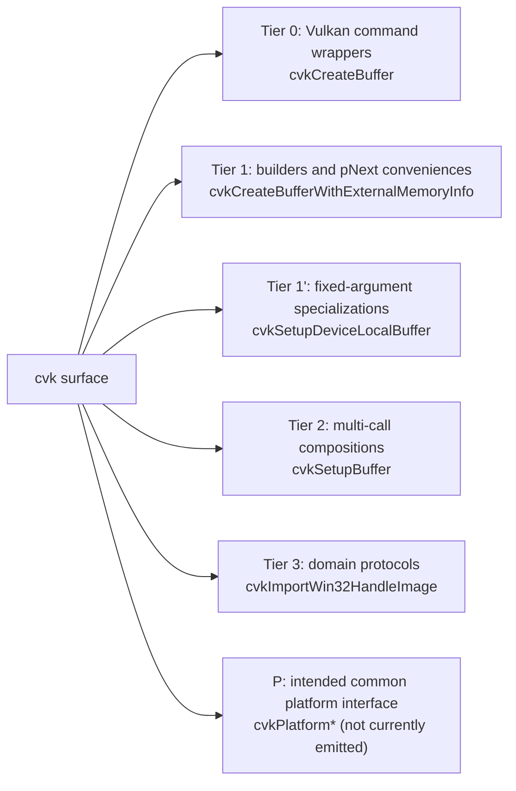
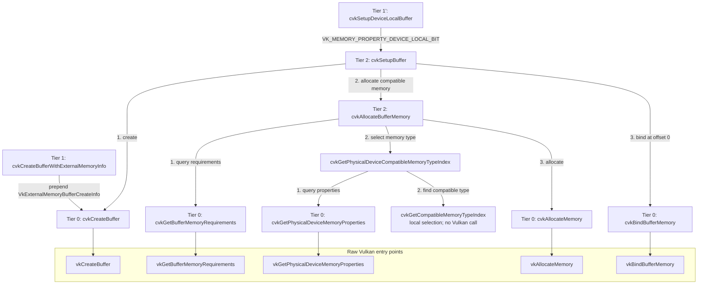

# cvk

Windows example: [ImmersiveWindowDemo](examples/ImmersiveWindowDemo/README.md)
ports the CDX demo's video renderer to Vulkan through CVK, retaining its native
caption and playback controls. [CastDemo](examples/CastDemo/README.md) plays a
video on a Google Cast receiver such as the XGIMI Horizon S over the network, reading
the receiver's JSON replies with the cvk JSON reader. Enable `CVK_BUILD_EXAMPLES` and
regenerate CMake to include both in the Visual Studio solution.

`cvk` is a procedural generator for a **hierarchical-compositional C wrapper** around the
Vulkan core and extension APIs. The wrapper it emits is a flat, fatal-on-error, assertion-heavy
C surface in which every raw `vkFoo` becomes `cvkFoo`, and progressively higher functions compose
lower ones without ever hiding Vulkan. This brief describes that pattern for first-time readers
so that generated output can be judged against a fixed set of rules rather than taste.

## 1. What the wrapper is

Every Vulkan entry point `vkFoo` becomes a `cvkFoo` function with the **same information
content, but flattened**: struct fields become positional parameters, `VkResult` is consumed
internally, and preconditions are asserted rather than documented away. On top of that flat base
sit progressively higher functions that *compose* lower ones. Each tier only removes a fixed
amount of boilerplate and fixes a fixed set of choices; nothing in the hierarchy is opaque.

A full surface covers instance, physical device, device, memory, image, buffer, descriptor,
pipeline, command buffer, barrier, transfer, dispatch, query, sync, surface, display, and
swapchain paths, with roughly two hundred functions in the core header and a few dozen per
platform header. Only `cvk` sources call `vk*` directly; everything above consumes the wrapper.

## 2. The tiers

Tiers are recognizable by name and by body shape. Each tier's body is *only* composition of
lower-tier calls plus local scratch, so any function can be read top-down to the raw call.

| Tier | Name shape | Body shape | Example |
|---|---|---|---|
| 0 | `cvk<VerbNoun>` | asserts, fill one `Vk*Info` from positional args, one `vk*` call under `CVK_CHECK`, assert outputs | `cvkCreateImage`, `cvkCreateBuffer`, `cvkCmdPipelineBarrier`, `cvkAllocateMemory` |
| 1 | tier 0 name + qualifier (`External`, `Dedicated`, `Exportable`, `Imported…Fd/…Win32`) | build one `pNext` extension struct, chain caller's `pNext` behind it, call tier 0 | `cvkCreateExternalImage`, `cvkAllocateDedicatedMemory`, `cvkAllocateExportableBufferMemory` |
| 1' | tier 0 name with specialization suffix or dropped args | forward to the general form with constants filled in | `cvkCmdImageBarrier` (queue families = `IGNORED`), `cvkCmdAcquireImageFromExternal` (src = `EXTERNAL`, top-of-pipe), `*2D` variants, `cvkWaitForFence` (count = 1) |
| 2 | `cvkSetup<Noun>` | create + allocate + bind, or create + query + select, in one call; returns every handle produced | `cvkSetupImage`, `cvkSetupBuffer`, `cvkSetupDevice`, `cvkSetupDeviceQueue`, `cvkSetupComputePipeline`, `cvkSetupSwapchain` |
| 3 | domain verbs: `Transfer…`, `Acquire/Release…`, `Dispatch…Items` | sequences of tier 0–2 calls that encode a *policy* (barrier before, copy, barrier after) | `cvkCmdTransferBufferToImageQueueOwnership`, `cvkCmdReleaseComputeBufferToExternal`, `cvkCmdDispatchComputeItems2D` |
| P (intended) | `cvkPlatform<Verb>` | proposed common signatures backed by each OS's tier 1–3 helpers; not currently emitted | `cvkPlatformSetupDeviceQueue`, `cvkPlatformExportImage`, `cvkPlatformImportImage`, `cvkPlatformGetInstanceExtensions` |

The tree groups functions by responsibility. Applications can call any tier; a composition
can call several lower-level helpers directly.



Platform folders contain functions from the applicable tiers. For example,
`win32/cvk_win32.h` exposes the tier-3 import protocol as well as Win32 command wrappers;
the folder does not define another call depth. A tier-1' specialization can also wrap a
tier-2 composition, as the buffer example below shows.

Two naming sub-rules matter for generation:

- **`Info` flip.** When Vulkan takes a pointer to an input struct (`vkGetMemoryFdKHR(device, pInfo, pFd)`),
  tier 0 keeps the struct pointer (`cvkGetMemoryFd`) and a sibling *flattens it* (`cvkGetMemoryInfoFd`,
  `cvkGetPhysicalDeviceImageFormatInfo2`, `cvkImportSemaphoreInfoFd`). The flattened one always
  calls the struct one. Both are public.
- **Qualifier stacking.** Qualifiers compose left to right in the name and inner to outer in the
  `pNext` chain: `cvkSetupExportableDedicatedMemoryBuffer` = create-external-buffer, then
  allocate-exportable-dedicated, then bind. The generator treats each qualifier as a
  `(pNext struct, extra parameters)` pair and stacks them mechanically.

### Worked example (from the generated buffer family)

These definitions use the house style from `.clang-format`: Allman braces, four-space
indentation, aligned parameter names and assignments, and pointer stars attached to types.
Locals use `snake_case` and are declared before statements; API parameters retain Vulkan's
camelCase names. The current policy disables generated input assertions; result checks and
output-handle assertions remain enabled.

```c
/* Tier 0: flatten VkBufferCreateInfo, one vk call, fatal on failure. */
void cvkCreateBuffer(VkDevice                     device,
                     const void*                  pNext,
                     VkBufferCreateFlags          flags,
                     VkDeviceSize                 size,
                     VkBufferUsageFlags           usage,
                     VkSharingMode                sharingMode,
                     uint32_t                     queueFamilyIndexCount,
                     const uint32_t*              pQueueFamilyIndices,
                     const VkAllocationCallbacks* pAllocator,
                     VkBuffer*                    pBuffer)
{
    VkBufferCreateInfo create_info;

    create_info.sType                 = VK_STRUCTURE_TYPE_BUFFER_CREATE_INFO;
    create_info.pNext                 = pNext;
    create_info.flags                 = flags;
    create_info.size                  = size;
    create_info.usage                 = usage;
    create_info.sharingMode           = sharingMode;
    create_info.queueFamilyIndexCount = queueFamilyIndexCount;
    create_info.pQueueFamilyIndices   = pQueueFamilyIndices;
    CVK_CHECK(vkCreateBuffer(device, &create_info, pAllocator, pBuffer));
    CVK_ASSERT(VK_NULL_HANDLE != (*pBuffer));
}

/* Tier 1: one extension struct in front of the caller's chain, then tier 0. */
void cvkCreateBufferWithExternalMemoryInfo(VkDevice                        device,
                                           const void*                     pNext,
                                           VkExternalMemoryHandleTypeFlags handleTypes,
                                           VkBufferCreateFlags             flags,
                                           VkDeviceSize                    size,
                                           VkBufferUsageFlags              usage,
                                           VkSharingMode                   sharingMode,
                                           uint32_t                        queueFamilyIndexCount,
                                           const uint32_t*                 pQueueFamilyIndices,
                                           const VkAllocationCallbacks*    pAllocator,
                                           VkBuffer*                       pBuffer)
{
    VkExternalMemoryBufferCreateInfo external_memory_buffer_create_info;

    external_memory_buffer_create_info.sType       = VK_STRUCTURE_TYPE_EXTERNAL_MEMORY_BUFFER_CREATE_INFO;
    external_memory_buffer_create_info.pNext       = pNext;
    external_memory_buffer_create_info.handleTypes = handleTypes;
    cvkCreateBuffer(device, &external_memory_buffer_create_info, flags, size, usage, sharingMode, queueFamilyIndexCount, pQueueFamilyIndices, pAllocator, pBuffer);
}

/* Tier 2: create, allocate, bind; every produced handle is an out-parameter. */
void cvkSetupBuffer(VkPhysicalDevice             physicalDevice,
                    VkDevice                     device,
                    const void*                  pBufferNext,
                    VkBufferCreateFlags          flags,
                    VkDeviceSize                 size,
                    VkBufferUsageFlags           usage,
                    VkSharingMode                sharingMode,
                    uint32_t                     queueFamilyIndexCount,
                    const uint32_t*              pQueueFamilyIndices,
                    VkMemoryPropertyFlags        requiredProperties,
                    const void*                  pMemoryNext,
                    const VkAllocationCallbacks* pAllocator,
                    VkBuffer*                    pBuffer,
                    VkDeviceMemory*              pMemory)
{
    cvkCreateBuffer(device, pBufferNext, flags, size, usage, sharingMode, queueFamilyIndexCount, pQueueFamilyIndices, pAllocator, pBuffer);
    cvkAllocateBufferMemory(physicalDevice, device, (*pBuffer), requiredProperties, pMemoryNext, pAllocator, pMemory);
    cvkBindBufferMemory(device, (*pBuffer), (*pMemory), 0);
}
```

The reference call graph below follows the generated buffer family in [src/cvk.c](src/cvk.c).
Each arrow means "calls"; numbered arrows give the call order within that caller.
The external-memory creator is a separate entry point that shares the same tier-0 creator.
Assertions, error handling, and struct assignments are omitted from the graph.



`cvkSetupDeviceLocalBuffer` supplies `VK_MEMORY_PROPERTY_DEVICE_LOCAL_BIT` to
`cvkSetupBuffer`. The setup returns the buffer and its memory through output parameters;
the caller owns both handles. The memory-type selector examines the reported type mask
and property flags locally, while tier-0 wrappers make the Vulkan calls.

## 3. Invariants every function keeps

- **Fatal, not fallible.** `CVK_CHECK` aborts on any non-success `VkResult`. Functions return
  `void` unless the value is a pure query (`VkBool32`, index, count, handle). There is no error
  path for callers; the only exceptions are queries that legitimately answer "unsupported" and
  set a zeroed output or `VK_FALSE`.
- **Assert every precondition.** Handles non-null, counts non-zero, `count == 0 || ptr != NULL`,
  formats not `UNDEFINED`, masks non-zero. Outputs are asserted after the call (`*pImage != NULL`).
- **`pNext` always threads through.** Every tier-0 creator takes `const void* pNext` for its main
  struct. Tier 1 accepts the caller's `pNext` and places it *behind* its own extension struct.
  Composite setups take one `pNext` per struct they build (`pImageNext`, `pMemoryNext`, `pQueueNext`).
- **`pAllocator` always threads through** to the leaf, even when the chosen policy passes `NULL`.
- **Fixed-capacity enumeration.** Two-call `vkEnumerate*` / `vkGet*` patterns write into
  caller-provided arrays sized by `CVK_MAX_*` constants (`VkPhysicalDevice p[CVK_MAX_PHYSICAL_DEVICES]`),
  with the count asserted against the cap. No heap allocation anywhere in the wrapper.
- **Commands call Volk's loaded entry points.** The application initializes and loads Volk
  before calling cvk; wrappers use its global `vk*` function pointers directly.
- **Positional argument order mirrors the Vulkan struct order**, prefixed by the owning handle(s),
  followed by `pAllocator`, then out-params last. Multi-struct setups interleave in
  creation order (image args, then memory args).
- **Optional Doxygen comments**: `doc_comments` in the shared policy controls API
  documentation blocks. It is currently `false` for both cvk and scvk.

## 4. Why the shape is generatable

The pattern is regular because none of its authoring rules depend on judgment:

1. Tier 0 is a pure function of `vk.xml`: command name, parameters, the single input struct
   (if any), its `sType`, and which parameters are outputs.
2. Tier 1 is a pure function of `vk.xml` `structextends` relations: for each `Vk*CreateInfo` /
   `Vk*AllocateInfo`, every extending struct yields one qualifier with that struct's fields as
   extra leading parameters.
3. Tier 1' variants are a small, finite table of constant substitutions (`VK_QUEUE_FAMILY_IGNORED`,
   `VK_QUEUE_FAMILY_EXTERNAL`, `TOP/BOTTOM_OF_PIPE`, `count = 1`, 3D→2D with `depth = 1`).
4. Tier 2 `cvkSetup*` functions follow one of a few templates: create→allocate→bind for anything
   with memory, filter-requested-extensions→create for device and instance, create→enumerate
   for swapchain.
5. Tier 3 and platform functions are the only ones that encode *application policy* and are the
   ones `cvk` treats as hand-authored input, not output.

The core header targets Vulkan 1.2 with selected KHR/EXT extensions; platform headers add, for
example, `VK_KHR_external_memory_fd`, `VK_EXT_image_drm_format_modifier`, and `VK_KHR_xlib_surface`
on Linux, and `VK_KHR_external_memory_win32`, `VK_KHR_external_semaphore_win32`, and
`VK_KHR_win32_surface` on Windows. Extension presence in a header is what decides which
tier 0/1 functions exist there.

## 5. What cvk produces

- `cvk.h` / `cvk.c` for tiers 0, 1, 1', and templated tier 2, generated from the Vulkan registry
  plus a small policy file (naming prefix, `CVK_MAX_*` capacities, which extensions and platforms
  to include, constant-substitution table).
- `cvk_json.h` / `cvk_json.c` for the JSON reader, generated type parsers, and pipeline
  JSON helpers; `scvk_json.h` / `scvk_json.c` provide the SC equivalents. JSON callers
  include these headers and link the same `cvk` or `scvk` library. Platform-specific
  parsers live in matching pairs such as `win32/cvk_win32_json.h` / `.c`.
- Per-platform headers (`include/xlib/cvk_xlib.h`, `include/win32/cvk_win32.h`) with the same
  tiers restricted to that platform's extensions, and matching sources under `src/<platform>/`.
  The `posix` protocol pair and `scvk` profile use the same layout. Include platform headers
  as, for example, `#include "win32/cvk_win32.h"` with `include/` on the include path.
  The default `"platforms": "all"` policy emits every category supported by each
  profile's registry, including `provisional/` for beta extensions. Unsupported
  categories produce no empty files; Vulkan SC currently emits Win32, QNX Screen,
  SCI, and the POSIX protocols.
- Optional Doxygen contracts generated from the registry's parameter descriptions;
  enable them with `"doc_comments": true` in the policy.
- Assertion sets derived mechanically: `optional="false"` handles → non-null assert, `len=`
  attributes → `count == 0 || ptr != NULL`, non-`optional` bitmasks → non-zero assert.

Out of scope for generation: tier 3 domain sequences, `cvkPlatform*`, the debug callbacks, and
format/plane arithmetic helpers (`cvkGetFormatPlaneLayout`, `cvkGetBufferImageCopyRegions`).
Those remain hand-written and are the consumers that the generated surface must satisfy.

## 6. Reading a generated surface

Read one family top to bottom in the core header:
`cvkCreateBuffer` → `cvkCreateExternalMemoryBuffer` → `cvkAllocateBufferMemory` →
`cvkAllocateExportableBufferMemory` → `cvkSetupBuffer` → `cvkSetupExportableMemoryBuffer`.
Then read `cvkCmdPipelineBarrier` → `cvkCmdImageQueueOwnershipBarrier` → `cvkCmdImageBarrier` →
`cvkCmdAcquireImageFromExternal` → `cvkCmdTransferBufferToImageQueueOwnership` →
`cvkCmdTransferBufferToImage2D`. Those two chains exhibit every tier and every naming rule here.

## 7. Optimized builds and Volk loading

Generated code targets C99. The headers contain no C++ linkage guards. Vulkan format
helpers use the pinned Vulkan-Utility-Libraries `vk_format_utils.h` header as a private
build dependency; Vulkan SC omits these Vulkan-only helpers.

Every build configuration enables speed optimization and link-time optimization (LTO)
for both `cvk` and `scvk`, and for the test executables: `/O2 /Ob3` with MSVC,
or `-O3` with GCC and Clang. Clang uses full LTO across the generated wrapper tiers.
MSVC Debug runtime checks are disabled because they conflict with optimization.
CMake checks LTO support during configuration. All build presets select Release:

```sh
cmake --preset windows-msvc-2026
cmake --build --preset windows-msvc-2026
ctest --test-dir build/windows-msvc-2026 -C Release --output-on-failure
```

Applications linking these static libraries should also enable
`INTERPROCEDURAL_OPTIMIZATION` on their executable target so optimization can cross
the application/library boundary. Generated functions use ordinary definitions;
the compiler decides which calls to inline.

Generation is independent of the host OS. CMake compiles the target's default platform
pairs; select others with a semicolon-separated `CVK_PLATFORMS` cache value, for example
`-DCVK_PLATFORMS="xcb;wayland;posix"`. An empty value builds only the core and JSON
sources. Native SDK headers must be available for the selected platforms. Add
`provisional` to compile beta helpers. The same selection configures Volk's dispatch
pointers and includes whichever platform pairs exist for `cvk` and `scvk`.

The `cvk` target links the pinned [Volk](https://github.com/zeux/volk) submodule privately and
exports `VK_NO_PROTOTYPES`. Its implementation and Volk use the current platform's Vulkan
define. Initialize submodules
with `git submodule update --init --recursive` before configuring. `cvk.h` includes
`vulkan/vulkan_core.h`; `scvk.h` includes `vulkan/vulkan_sc_core.h`. Volk is included only
by cvk's implementation files. Application code that initializes Volk includes `<volk.h>`
itself and links `volk::volk`. Do not also link `Vulkan::Vulkan` / `vulkan-1`.

The application owns loading:

1. Call `volkInitialize()` and check its result before creating the instance.
2. Create the instance, then call `volkLoadInstance(instance)` before instance/device work.
3. Optionally call `volkLoadDevice(device)` after device creation for device-specific pointers.

Required functions must be loaded before entering cvk, including compositions that use
extension commands. `volkLoadDevice` selects one device's global pointers; cvk does not
select devices or use `VolkDeviceTable`. With several devices, use instance-loaded dispatch
or manage loading at the application level. See [Volk's loading documentation](https://github.com/zeux/volk#basic-usage).
Generated functions call the loaded `vk*` pointers directly. The extra parent device or
instance arguments formerly used only for lookup have been removed, along with cache APIs.

`scvk` remains a separate Vulkan SC library using SC headers and direct SC entry points;
its application links the SC implementation. Standard Volk is used only by `cvk`.

## Generation configuration

Generation options live in `cvk.policy.json`, independently of CMake:

```json
"doc_comments": false,
"single_line_prototypes": true,
"designated_initializers": true
```

These settings omit API doc comments and put each function prototype on exactly one
line, even when it exceeds clang-format's column limit. Generated declaration sections
carry clang-format off/on directives so standalone formatting also preserves the policy.
Function definitions keep their
normal formatting. Set `"designated_initializers": true` to make builders and generated wrappers use
C99 designated initializers with Allman braces instead of separate member assignments:

```c
(*pInfo) = (VkExtent2D)
{
    .width  = width,
    .height = height
};
```

The generator restores Allman initializer braces after clang-format; running clang-format
alone may rejoin them. Fixed arrays are copied through a temporary;
Returned-only builders and updates to caller-provided output storage still change only
the required fields, preserving existing output members and buffer pointers.
The default is true; set it to false for separate member assignments. `scvk.policy.json` inherits these options. A separate JSON policy can
use `"extends": "cvk.policy.json"` and override any setting; select it with `--policy`.

```sh
python scripts/generate.py --policy cvk.policy.json
python scripts/generate.py --policy scvk.policy.json
```

## Vulkan structures by command

[study/coverage.html](study/coverage.html) is a searchable map from Vulkan commands and
structures to cvk wrappers, builders, and extender conveniences, with source locations.
[study/coverage.md](study/coverage.md) summarizes command coverage, excluded platforms,
and output-array chain limitations; [study/coverage.json](study/coverage.json) contains
the complete map. Coverage is checked against declarations, definitions, and Vulkan
call/dispatch sites in the current generated files. It measures API surface, not
Vulkan conformance. Regenerate it after the structure inventory below:

```sh
python scripts/study_coverage.py
```

[study/command_structs.md](study/command_structs.md) lists structures for every Vulkan
command in the pinned registry: direct input/output parameters, nested members, and
allowed `pNext` extenders with their exact chain bases. Command aliases share a section;
structure aliases appear in an appendix. It covers all core versions and supported
extensions, including every platform, independently of the wrapper policy.
[study/command_structs.json](study/command_structs.json) contains the same relationships
plus structure origins, aliases, `sType`, and registry attributes for further processing.

Regenerate both reports:

```sh
python scripts/study_command_structs.py --json study/command_structs.json
```

Dump only query commands, or filter by command-name glob (`--command` is repeatable):

```sh
python scripts/study_command_structs.py --queries-only --out study/query_structs.md
python scripts/study_command_structs.py --command "vkGetPhysicalDevice*" --out study/physical_device_structs.md
```

The dump preserves registry relationships; command-specific valid usage and device
feature/extension requirements still determine which combinations can actually be used.
It does not infer typed contents of opaque `void*` payloads or callback parameters.
Use `--xml PATH --api vulkansc` to inspect the Vulkan SC registry instead.
